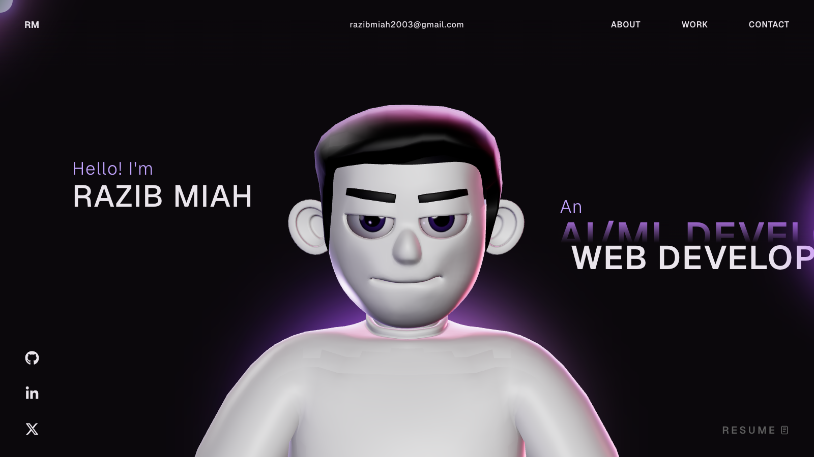

# Razib Miah — Portfolio

[](https://razibmiah.vercel.app)

**Live site: https://razibmiah.vercel.app**

My personal 3D portfolio website. I'm an AI/ML and web developer who learns by building, from C console systems to machine learning notebooks and Next.js web apps.

---

## 👋 About Me

- 🤖 Learning and building in **machine learning and deep learning** with Python, TensorFlow, and PyTorch
- 🎓 Started my AI/ML journey with the **Phitron AIML** program
- 🌐 Building web apps with **Next.js, React, and TypeScript**
- 💻 Strong foundations in **C**, data structures, and algorithms

> "And that there is not for man except that for which he strives." (Quran 53:39)

---

## 📂 Featured Projects

| Project | Tech |
| --- | --- |
| [Digital Legal Aid System](https://github.com/razibr246/Digital-Legal-Aid-System) | Next.js, React, TypeScript |
| [Advanced Deep Learning Deep Dive](https://github.com/razibr246/Advanced-Deep-Learning-Deep-Dive) | Python, PyTorch |
| [Machine Learning Marathon](https://github.com/razibr246/Machine-Learning-Marathon) | Python, TensorFlow, scikit-learn, NLTK |
| [Dive into the Sea of Deep Learning](https://github.com/razibr246/Dive-into-the-sea-of-Deep-Learning) | Python, TensorFlow, NumPy |
| [Transport Management System](https://github.com/razibr246/transport-management-system-c) | C |

---

## 🧰 Built With

**React** · **TypeScript** · **Three.js / WebGL** · **GSAP** · **Vite** · deployed on **Vercel**

---

## 🚀 Run Locally

```bash
git clone https://github.com/razibr246/Razib-Miah-Protfolio.git
cd Razib-Miah-Protfolio
npm install
npm run dev
```

The chat assistant on the Play page needs a `GROQ_API_KEY` environment variable.

---

## 🤝 Connect

- GitHub: https://github.com/razibr246
- LinkedIn: https://www.linkedin.com/in/razibr246/
- X: https://x.com/razibr246
- Email: razibmiah2003@gmail.com

---

## 🪪 License

MIT License. Based on the open-source 3D portfolio template by Redoyanul Haque. See [LICENSE](LICENSE).
